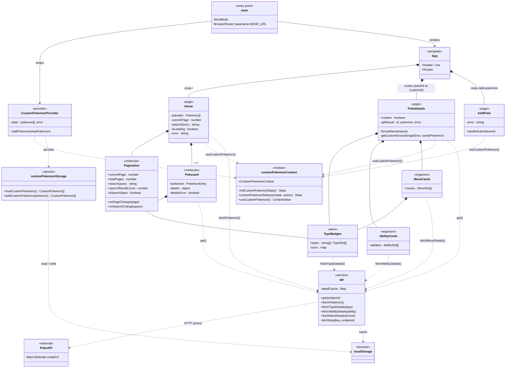
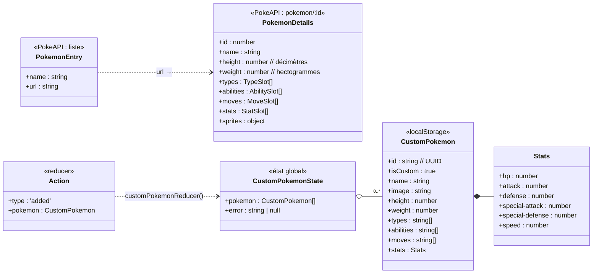
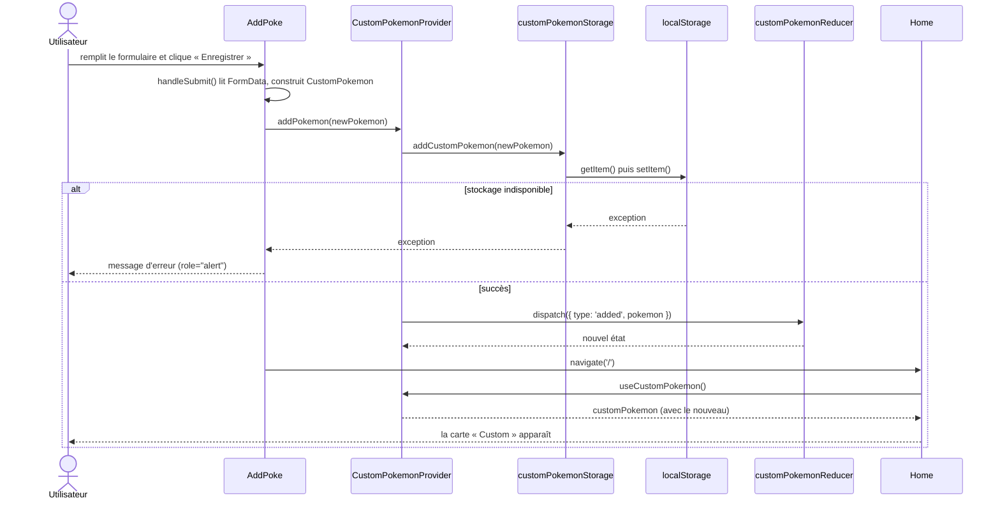
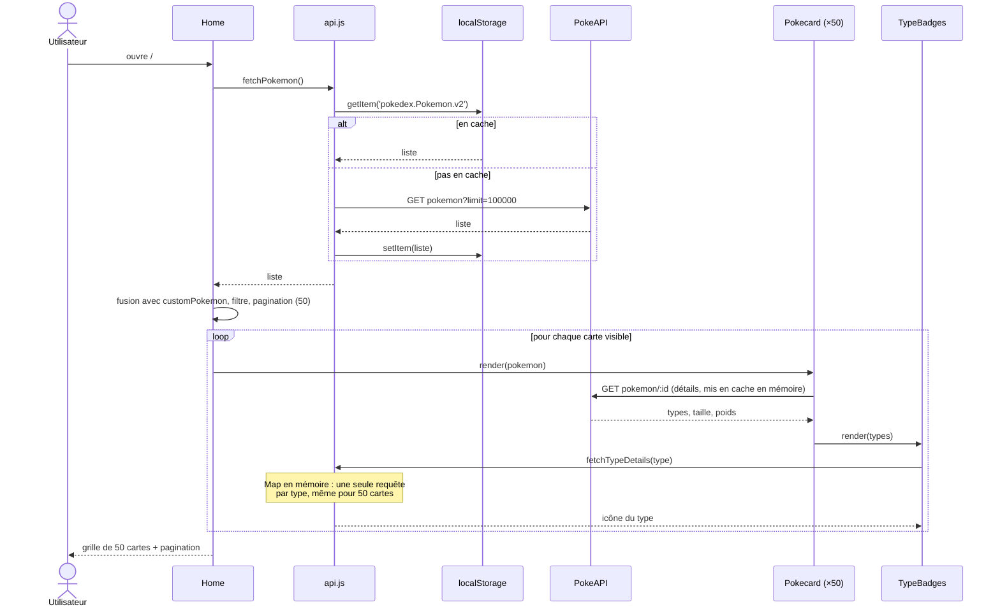
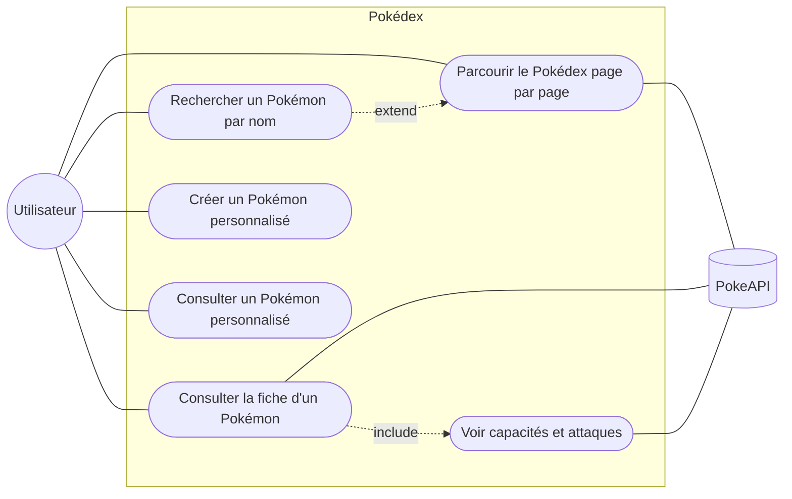

# Diagrammes UML — Pokédex

Les diagrammes sont écrits en [Mermaid](https://mermaid.js.org/) : GitHub les affiche directement.

1. [Diagramme de classes — architecture](#1-diagramme-de-classes--architecture)
2. [Diagramme de classes — modèle de données](#2-diagramme-de-classes--modèle-de-données)
3. [Diagramme de séquence — ajouter un Pokémon](#3-diagramme-de-séquence--ajouter-un-pokémon)
4. [Diagramme de séquence — afficher le Pokédex](#4-diagramme-de-séquence--afficher-le-pokédex)
5. [Diagramme de cas d'utilisation](#5-diagramme-de-cas-dutilisation)

Les composants React sont représentés comme des classes : les **props** sont des attributs publics (`+`), l'**état local** (`useState`) des attributs privés (`-`), et les fonctions internes des méthodes privées.

---

## 1. Diagramme de classes — architecture

**Légende :** `*--` composition (le parent rend l'enfant), `-->` association, `..>` dépendance (utilise / appelle).

---

## 2. Diagramme de classes — modèle de données

`Home` affiche une liste qui mélange les deux sources : `[...PokemonEntry[], ...CustomPokemon[]]`. `Pokecard` les distingue grâce à `isCustom`.

---

## 3. Diagramme de séquence — ajouter un Pokémon

---

## 4. Diagramme de séquence — afficher le Pokédex

---

## 5. Diagramme de cas d'utilisation

Mermaid n'a pas de diagramme de cas d'utilisation natif ; il est représenté ici avec un graphe.

